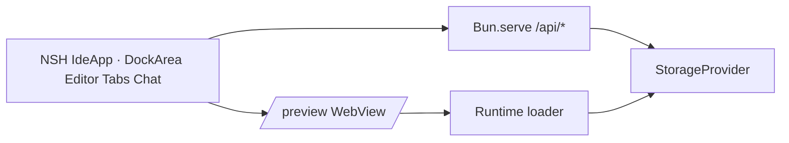

# nshde context

Living map of domain language and architecture. Update this when behavior or vocabulary changes.

## Product

**nshde** is a recursive web IDE: agents write modules, storage persists them, the runtime hot-mounts them in the preview pane.

## Domain terms

| Term | Meaning |
|------|---------|
| **NSH shell component** | TSX module (`.nsh.tsx`) meant to run in the sandboxed runtime, NSH-style |
| **Object tree** | NSH UI listing stored paths under `components/` |
| **Agent** | Template role (Architect, Implementer, Reviewer) that generates module source from a prompt |
| **Storage backend** | `fs` (`.nshde-data/`), `memory`, or `s3` — where module files live |
| **Runtime loader** | React sandbox in `/preview` (Sucrase + optional WASM); IDE chrome is NSH (`App.tsx`) |
| **Mount / run** | Load a module path into the runtime preview WebView |

## Runtime stack

## UI stack

- **Shell**: NSH TSX entry `App.tsx` → `IdeApp` with `nsh/base` `DockArea`, `Editor`, `Tabs`, `Sheet`, `TextView`, `WebView` (gallery patterns).
- **Dock chrome**: Side/bottom docks use `renderDock` headers; **left/right collapse** closes the dock (`open: false`) and shows a **`w-7` (28px) rail** beside `DockArea`. **Bottom** uses a 28px-tall in-dock rail. Collapse state is **per dock** via `dockRailsCollapsed`.
- **API bridge**: `host.js` + `src/nshde/api.ts` (`host.call` or `fetch` to port 43123).
- **Dev**: `bun run dev:api` + `nsh run App.tsx --target web`.

## API surface

- `GET/POST/DELETE /api/storage` — read/write/tree/delete module files
- `GET/POST /api/agents` — list agents; generate module from prompt
- `GET /api/config` — active storage backend and options
- `GET /preview` — React sandbox iframe for mounted modules

## Out of scope (today)

Signed packages, capability tokens, real S3 SDK wiring, LLM-backed agents (stubs only), dynamic NSH compilation of user modules in-process (preview still uses the React sandbox).
