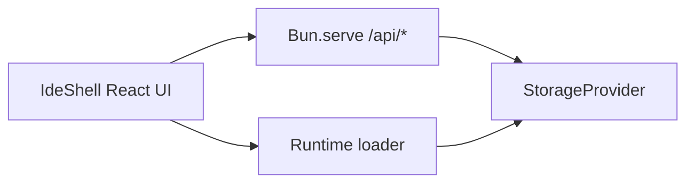

# nshde context

Living map of domain language and architecture. Update this when behavior or vocabulary changes.

## Product

**nshde** is a recursive web IDE: agents write modules, storage persists them, the runtime hot-mounts them in the preview pane.

## Domain terms

| Term | Meaning |
|------|---------|
| **NSH shell component** | TSX module (`.nsh.tsx`) meant to run in the sandboxed runtime, NSH-style |
| **Object tree** | Browser UI listing stored paths under `components/` |
| **Agent** | Template role (Architect, Implementer, Reviewer) that generates module source from a prompt |
| **Storage backend** | `fs` (`.nshde-data/`), `memory`, or `s3` — where module files live |
| **Runtime loader** | Client-side Sucrase sandbox for TSX; WebAssembly path for `.wasm` with `nsh_host` imports |
| **Mount / run** | Load a module path into the runtime preview |

## Runtime stack

## API surface

- `GET/POST/DELETE /api/storage` — read/write/tree/delete module files
- `GET/POST /api/agents` — list agents; generate module from prompt
- `GET /api/config` — active storage backend and options

## Out of scope (today)

Signed packages, capability tokens, real S3 SDK wiring, LLM-backed agents (stubs only).
