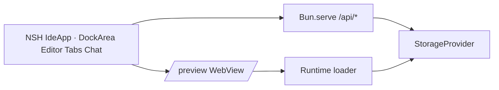

# nshde context

Living map of domain language and architecture. Update this when behavior or vocabulary changes.

## Product

**nshde** is a recursive web IDE: agents write modules, storage persists them, the runtime hot-mounts them in the preview pane.

## Domain terms

| Term | Meaning |
|------|---------|
| **NSH shell component** | TSX module (`.nsh.tsx`) meant to run in the sandboxed runtime, NSH-style |
| **Object tree** | NSH UI listing stored paths under `components/` |
| **Agent** | Template role (Architect, Implementer, Reviewer) that generates module source from a prompt |
| **Storage backend** | `fs` (`.nshde-data/`), `memory`, or `s3` — where module files live |
| **Runtime loader** | React sandbox in `/preview` (Sucrase + optional WASM); IDE chrome is NSH (`App.tsx`) |
| **Mount / run** | Load a module path into the runtime preview WebView |

## Runtime stack

## UI stack

- **Shell**: NSH TSX entry `App.tsx` → `IdeApp`. Flat workspace: a title toolbar of `Button`s, activity rails, `DockArea`, status bar. This `nsh` 0.3.0 build exports `DockArea`, `Collapsible`, `Editor`, `Tabs`, and `TextView`. `Toolbar` and `Toggle` are on nsh.dev but not in this binary, so the bars are rows of `Button`s with `selected`.
- **Docks**: Agents on the left, Explorer (object tree) on the right, Runtime on the bottom. Each dock has one tab row. Editor tabs use a top edge on the active tab; a dirty file's title and Save button use the warn color. `mod+b` toggles agents, `mod+j` toggles runtime, `mod+s` saves.
- **Collapse**: An open dock cannot be shorter than 100 points, so closing one does not shrink it to a strip inside `DockArea`. Side docks leave the activity rail: a robot for agents, a tree for the explorer (white closed, brand open). Runtime leaves one tab strip, only as wide as the editor column. The title-bar layout glyphs track the same open state.
- **Tabs**: Any panel can be dragged into any other tab group, including Explorer and Runtime. File, settings, and conversation tabs close, including the last editor tab.
- **Agent dock**: A horizontal split. The session list is the gallery chat sidebar (new session, then the list). Each session is a tab in the conversation group. The composer is the gallery field with suggestion chips; the role is a menu at the bottom left of the field.
- **API bridge**: `host.js` + `src/nshde/api.ts` (`host.call` or `fetch` to port 43123).
- **Dev**: `bun run dev:api` + `nsh run App.tsx --target web`.
- **Production / Koyeb**: root `Dockerfile` (Bun 1.4+, matches `bun.lock` v2) installs `nsh`, runs `nsh package . --target web`, then `bun src/server.ts` serves the IDE and `/api/*` on `PORT`; use Dockerfile builder on Koyeb (not Node buildpacks).

## API surface

- `GET/POST/DELETE /api/storage` — read/write/tree/delete module files
- `GET/POST /api/agents` — list agents; generate module from prompt
- `GET /api/config` — active storage backend and options
- `GET /preview` — React sandbox iframe for mounted modules

## Out of scope (today)

Signed packages, capability tokens, real S3 SDK wiring, LLM-backed agents (stubs only), dynamic NSH compilation of user modules in-process (preview still uses the React sandbox).
