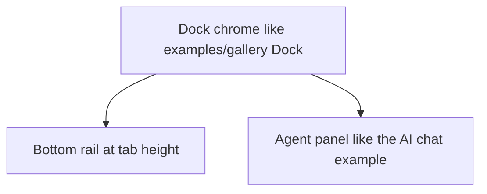

# Gallery dock panes

Match the gallery Dock example for the left and right docks, collapse the runtime to a tab-height rail, and restyle the agent panel after the gallery AI chat.

## Dependency graph

## Slices

1. Left and right docks use the gallery tab and `renderDock` header. Hide closes the dock. The title bar toggles them open again.
2. The bottom dock closes instead of shrinking. DockArea keeps an open dock at least 100 points, so the collapsed runtime is an `h-9` tab rail under the area, the same height as a gallery tab.
3. The agent panel uses the AI chat transcript, suggestion chips, segmented agent control, and rounded composer.

## Done when

- Left and right panes show gallery tabs and a Hide strip, and reopen from the title bar.
- Collapsing the runtime leaves only that tab rail.
- The agent panel follows the AI chat example and still generates a module.
