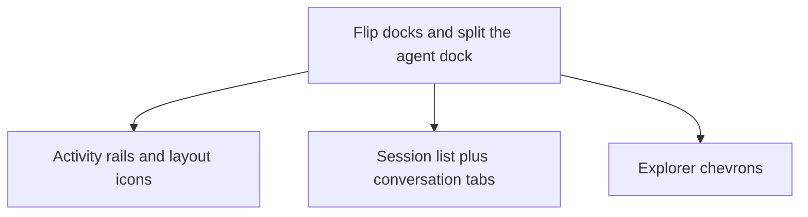

# IDE shell

Make the workspace behave like Zed and VS Code: agents on the left, the object tree on the right, and a collapse that leaves a rail.

## Dependency graph

## Slices

1. Left dock is Agents, right dock is Explorer, bottom dock is Runtime. The outer card chrome goes away.
2. Collapsing a side dock leaves the activity rail and the toolbar layout icon. Collapsing Runtime leaves its tab strip. DockArea will not draw an open dock under 100 points, so the rails sit outside the area.
3. The agent dock is a split: session list, then one tab per conversation, following the gallery chat sidebar and dock tabs.
4. Explorer rows use a rotating chevron. Panel toggles use the same layout glyphs as the reference screenshots.
5. Title bar and editor path are toolbar rows of `Button`s. This nsh 0.3.0 build has no `Toolbar` export.

## Done when

- Agents sit on the left as two panes, Explorer on the right.
- Collapsing any pane leaves a control that opens it again, in place.
- A new session opens as its own conversation tab.
- Headless tests cover collapse, and the running IDE shows the same layout.
