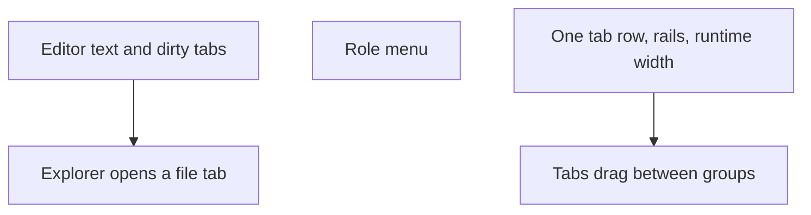

# Editor and chrome

Make the editor usable, and make each dock a single tab row that still collapses.

## Dependency graph

## Slices

1. The editor keeps its own text. A keystroke used to be stored as empty and the view was rebuilt, so the text vanished.
2. File tabs close, including the last one. A dirty file's tab title and Save button use the warn color.
3. Choosing a file in the explorer opens it in the center via the dock's `addPanel`.
4. Every panel is draggable, including Explorer and Runtime. DockArea only moves a panel marked closable, and only when its group has something beside it. Explorer and Runtime therefore sit in the center split (beside the editor), not as the only child of a dock.
5. The agent role is a menu at the bottom left of the composer. The segmented control did not follow the selected role.
6. Dock headers are gone, so Agents, Explorer, and Runtime each have one tab row. Side rails use a robot and a tree. The collapsed runtime strip is only as wide as the editor, and the open runtime row still collapses.

## Done when

- Typing in the editor leaves the text in place.
- A file from the explorer opens as its own closable tab.
- Runtime is one collapsible row, and the collapsed strip matches the editor width.
- Headless tests cover the file tab and the role menu.
