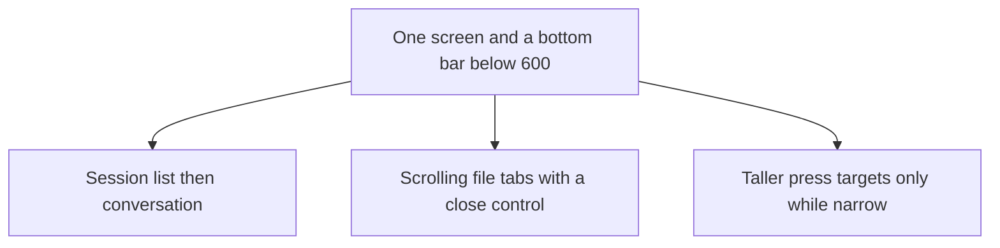

# Phone shell

Make the workspace usable below DockArea's compact breakpoint without changing the wide layout.

## Dependency graph

## Slices

1. Below 600 points, do not mount `DockArea`. Its left dock is a drawer as wide as the 520-point agents pane, so on a phone it covers the page and leaves no backdrop to dismiss. Explorer and Runtime are center groups, so the compact tab bar mixes them with files.
2. A bottom bar switches Editor, Agents, Files, and Run. Each is a full screen. Agents are a list, then the conversation, with Back to sessions. Opening a file or mounting a module shows that screen.
3. File tabs scroll. Close is always on the tab, because a phone has no hover. The wide dock's tab row is untouched.
4. Rows, the save control, the composer, and the tree's mount button grow to a 44-point target only while the window is under 600. At 600 and wider the class strings stay the ones the desktop shell already uses.

## Done when

- On a 390-point web viewport, each section opens and the editor is reachable again. A file tab closes. A file from the explorer opens in the editor.
- On a 1280-point viewport, agents, the explorer, and the editor still sit together, and the phone bar is absent.
