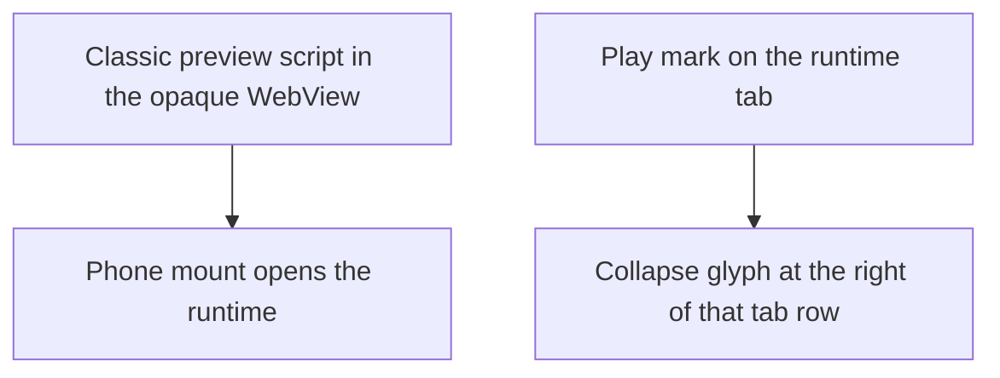

# Runtime preview and its icon

Make a mounted TSX module actually run inside the runtime WebView, and give Runtime its own mark.

## Dependency graph

## Slices

1. The web WebView sandboxes a same-origin page without `allow-same-origin`. The preview was a module script, which that opaque origin refuses, so the pane stayed blank wherever the IDE and the API share an origin. Serve the preview as a classic script plus its stylesheet.
2. Mounting a module on a phone opens the runtime section. The preview fills that section.
3. The runtime tab shows a play mark. The collapse glyph, which used to sit in the tab, sits at the right edge of that tab row.

## Done when

- A sandboxed same-origin preview frame renders the welcome module.
- On a 390-point viewport, mounting a module leaves the explorer and shows the runtime.
- On a 1280-point viewport, Collapse runtime hides the pane and leaves the rail.
